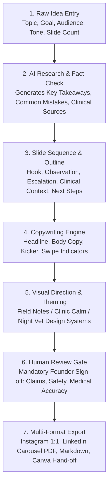

# Practo for Animals — Platform & AI Content Studio Specification

> **Animal-Care Discovery Engine, AI Education Academy, & AI Content Creation Studio**  
> *Built with Next.js 16.4.5 (App Router, Turbopack), React 19, Tailwind CSS 4, and TypeScript 5.*

---

## Submission Overview

This documentation outlines the design, architecture, and deliverables for the three core platform capabilities:

1. **Practo for Animals — MVP Design:** A modern animal-care discovery engine covering veterinary clinics, multi-specialty hospitals, 24/7 emergency ICUs, boarding facilities, diagnostics, ambulance networks, and rescue NGOs.
2. **AI Education — Course Landing Page (`/education`):** An educational portal tailored for students, veterinary teams, and young professionals seeking hands-on AI and workflow-automation skills.
3. **AI-Powered Content Creation System (`/content-studio`):** An in-app studio enabling solo founders to transform raw ideas into publish-ready Instagram and LinkedIn carousels with built-in veterinary medical compliance checks.

---

## 1. Practo for Animals — MVP Design

### 1.1 Essential MVP Elements & User Experience
The discovery platform is engineered to eliminate friction in critical, high-stress animal care situations while providing an effortless interface for routine wellness visits:

* **Cinematic Video Hero (`/`):** Instant visual reassurance with a natural-color video background showcasing animal care in full clarity, key trust indicators (Accredited Clinical Network, 14,200+ Verified Vets & Hospitals, 24/7 Rapid Triage), and a unified search card.
* **Species-First Taxonomy:** Instant visual paths for **Canines, Felines, Avian, Lagomorphs (Rabbits), Equine, Livestock, and Exotics**.
* **Comprehensive Provider Search & Filtering Engine (`/find`):** Dynamic multi-attribute filtering with instant results, distance indicators, and direct actions.
* **Direct Clinical Engagement:** Dedicated appointment booking modal (`/book-appointment`), emergency one-tap call lines, and full operating schedules.
* **Community Data Integrity (`/submit-correction`):** Crowdsourced correction queue allowing pet parents and veterinarians to propose updates to phone numbers, addresses, and services to keep directory information fresh.
* **Provider Monetisation & Onboarding (`/list-business`):** Self-serve onboarding funnel allowing clinics, hospitals, and pet businesses to apply for verified listings.

### 1.2 Useful Filters & Provider Information Architecture

| Filter Category | Options & Logic | Purpose |
| :--- | :--- | :--- |
| **Species Supported** | Dogs, Cats, Birds, Rabbits, Horses, Farm Animals, Exotics | Ensures specialized veterinarians (e.g. avian or exotic specialists) are easily located. |
| **Care Category** | Vet Clinic, 24/7 Animal Hospital, Boarding & Daycare, Diagnostics, Pet Ambulance, Rescue NGO | Segregates emergency critical care from routine services. |
| **Location & Proximity** | City, Neighborhood (e.g., Koramangala, Indiranagar, Bandra, Adyar) + "Locate Me" GPS | Prioritizes nearest emergency triage facilities. |
| **Emergency & Hours** | Open 24 Hours, Public Holidays, Weekend Slots, Quiet Hours | Life-saving filter for after-hours critical trauma and toxicity cases. |
| **Verification Status** | Accredited, Verified Badge, Community Endorsed | Builds user trust and surfaces clinically audited practices. |

#### Provider Card Information Hierarchy:
1. **Clinic Name & Verified Badge:** Verified status icon and category tag.
2. **Key Capabilities:** Surgery, ICU, Digital X-Ray, In-house Lab, Ultrasound, Dental, Boarding.
3. **Emergency Readiness:** Highlighted badge for 24/7 Emergency & Critical Care.
4. **Location & Distance:** Physical address, city, and neighborhood marker.
5. **Direct Actions:** `[Book Appointment]` (primary CTA), `[Call Clinic]` (direct dial), and `[View Profile]`.

### 1.3 Key Calls to Action (CTAs)

* **Find a Vet (`/find`):** Primary discovery action in hero and top navigation; launches instant filtered search.
* **Book Appointment (`/book-appointment`):** Prominent action button in header and on every provider listing.
* **24/7 Rapid Triage (Hero Badge & Filter):** Direct access to emergency facilities and ambulance contacts.
* **List Your Business (`/list-business`):** Partnership gateway for clinic owners and pet businesses.
* **Submit a Correction (`/submit-correction`):** Community link safeguarding directory accuracy.

### 1.4 Attractive, Intuitive & Mobile-Friendly UX Design
* **Thumb-Zone Optimized:** Primary search controls and bottom action bars positioned for comfortable one-handed mobile navigation.
* **Design System Palette:** Forest Green (`#103a2f`), Deep Mint (`#059669`), Warm Ivory (`#fbf8f2`), and Sandline borders (`#e8e2d5`) conveying clinical authority without sterile hospital coldness.
* **Instant Visual Feedback:** Micro-animations on species selection cards, smooth hover states, and dynamic status pills.

---

## 2. AI Education — Course Landing Page

### 2.1 Page Structure & Section Progression (`/education`)
The educational portal is structured to maximize engagement and conversion for students and early-career professionals:

```
┌─────────────────────────────────────────────────────────────┐
│ 1. HERO SECTION: Kicker Badge, Headline, Video/Graphic      │
│    Value Proposition, Primary "Enroll Now" & Syllabus CTAs  │
├─────────────────────────────────────────────────────────────┤
│ 2. VALUE METRICS: Hours of Hands-on Building, Real Projects │
│    Student Community, Certificate of Applied Competency     │
├─────────────────────────────────────────────────────────────┤
│ 3. PROGRAMME CATALOGUE: Tabbed / Card View of Courses       │
│    - AI for Animal Health & Veterinary Teams                │
│    - Clinic Automation Sprint (n8n & Workflow Systems)      │
│    - AI Content Systems for Pet-Care Brands                 │
├─────────────────────────────────────────────────────────────┤
│ 4. CURRICULUM ACCORDION: Week-by-Week Breakdown             │
│    Lectures, Tool Stack, Hands-on Prompts, Capstone Output  │
├─────────────────────────────────────────────────────────────┤
│ 5. LEAD CAPTURE & REGISTRATION FORM: Interactive Form       │
│    Role Selector, Learning Goals, Instant Seat Reservation  │
├─────────────────────────────────────────────────────────────┤
│ 6. FREQUENTLY ASKED QUESTIONS: Dynamic Accordion            │
└─────────────────────────────────────────────────────────────┘
```

### 2.2 Core Value Proposition
* **Practical, Applied Focus:** Every module culminates in a functional production artefact (an automated triage workflow, a content engine, or a patient follow-up workflow).
* **Domain-Specific Advantage:** Merges modern AI engineering with real healthcare, veterinary, and marketing applications.
* **Accessible to Non-Engineers:** Built for clinic managers, vet students, animal welfare teams, and digital skills learners without heavy programming prerequisites.

### 2.3 Registration & Lead-Capture Journey


1. **Discovery:** User reviews course modules, software tools covered, and learning outcomes.
2. **Registration Module:** Captures Name, Email, Phone, Current Role (Student, Veterinarian, Clinic Owner, Marketer), and specific learning goals.
3. **Data Integrity:** Protected by client-side and server-side validation with explicit communication consent.
4. **Follow-up Pipeline:** Submissions populate the platform review queue for cohort onboarding.

---

## 3. AI-Powered Content Creation System

### 3.1 The Founder's Repeatable Workflow (`/content-studio`)
A complete 6-stage human-in-the-loop pipeline allowing a solo founder to produce professional, medically sound Instagram and LinkedIn carousels without an in-house graphic designer:



### 3.2 Stage-by-Stage Breakdown

1. **Stage 1 — Raw Idea Entry:** Founder enters a brief prompt (e.g., *"Itchy skin in monsoons: what pet parents should check before changing foods"*), selects audience (*Pet Parents*), channel (*Instagram*), tone (*Warm-Practical*), and length (*6 slides*).
2. **Stage 2 — AI Research Synthesis:** System synthesizes key veterinary takeaways, common misconceptions, and clinical guardrails.
3. **Stage 3 — Structured Outline:** AI constructs an engagement sequence: Hook Slide $\rightarrow$ Problem Observation $\rightarrow$ Practical Check $\rightarrow$ Red-Flag Warnings $\rightarrow$ Veterinary Action $\rightarrow$ Call to Action.
4. **Stage 4 — Slide Copywriting:** Generates concise text tailored for 1080x1080 and 1080x1350 aspect ratios with kicker badges, bold anchor text, and swipe cues.
5. **Stage 5 — Visual Direction & Theming Engine:** The system applies one of three curated design palettes:
   * **Field Notes:** Warm earthy paper tones, editorial typography, natural veterinary feel.
   * **Clinic Calm:** Soft sage green, high legibility, reassuring wellness aesthetic.
   * **Night Vet:** Deep charcoal/navy, high-contrast amber accents, urgent triage guides.
6. **Stage 6 — Human Review Gate:** Mandatory 6-point checklist before export:
   * [x] No unauthorized medical diagnoses or drug prescriptions.
   * [x] Escalation to physical veterinary care is clearly stated.
   * [x] Tone matches selected brand guidelines.
   * [x] Layout and text fit safe reading zones.
   * [x] Source citations verified.
   * [x] Named founder sign-off recorded.
7. **Stage 7 — Multi-Format Export:**
   * **LinkedIn:** Paginated PDF deck ready for document upload.
   * **Instagram:** High-resolution PNG slide package.
   * **Canva Integration:** Direct template hand-off link for optional custom embellishments.
   * **Markdown/JSON:** Raw copy for newsletter and blog re-purposing.

### 3.3 Production Sample Carousel Deliverable

* **Reference ID:** `CS-A7K2Q9`
* **Topic:** Monsoon skin checks: what to notice before changing foods
* **Audience:** Pet Parents | **Channel:** Instagram / LinkedIn (1080x1080) | **Theme:** Field Notes

```
┌───────────────────────────┐ ┌───────────────────────────┐ ┌───────────────────────────┐
│ SLIDE 01 (HOOK)           │ │ SLIDE 02 (OBSERVATION)    │ │ SLIDE 03 (THE MISTAKE)    │
│ Kicker: SEASONAL CARE     │ │ Kicker: CHECK THE PAWS    │ │ Kicker: COMMON PITFALL    │
│                           │ │                           │ │                           │
│ Itchy skin in monsoon:    │ │ Check paws and ear folds  │ │ Don't switch foods        │
│ What to notice before     │ │ before changing diet.     │ │ immediately.              │
│ changing foods.           │ │                           │ │                           │
│                           │ │ High humidity causes yeast│ │ Food allergies take weeks │
│ 🐾 Swipe for 4 signs ➜    │ │ flares, not just allergies│ │ to show; damp fur is      │
│                           │ │                           │ │ often the primary culprit.│
└───────────────────────────┘ └───────────────────────────┘ └───────────────────────────┘
┌───────────────────────────┐ ┌───────────────────────────┐ ┌───────────────────────────┐
│ SLIDE 04 (HOME ACTIONS)   │ │ SLIDE 05 (RED FLAGS)      │ │ SLIDE 06 (ACTION CTA)     │
│ Kicker: DAILY ROUTINE     │ │ Kicker: WHEN TO SEE A VET │ │ Kicker: NEXT STEPS        │
│                           │ │                           │ │                           │
│ 3 steps after every walk: │ │ See a veterinarian if:    │ │ Better care starts        │
│ 1. Dry paws & webbing     │ │ ⚠️ Skin is hot or oozing  │ │ with noticing early.      │
│ 2. Check for red ear skin │ │ ⚠️ Constant head shaking  │ │                           │
│ 3. Brush coat to aerate   │ │ ⚠️ Paw chewing won't stop │ │ Find trusted clinics      │
│                           │ │                           │ │ on Practo for Animals.    │
│ Simple habits save visits.│ │ Don't wait for lesions.   │ │ 🔗 Link in bio            │
└───────────────────────────┘ └───────────────────────────┘ └───────────────────────────┘
```

---

## 4. Recommended Technology Stack & Architecture

| Layer | Technology | Rationale |
| :--- | :--- | :--- |
| **Frontend Framework** | **Next.js 16.4.5 (App Router, Turbopack)** | Server Components for instant rendering, SEO indexing, and streamlined routing. |
| **UI Components & Styling** | **Tailwind CSS 4 + Lucide Icons** | Modern utility-first styling with high performance and accessible primitives. |
| **Application State & Data** | **Modular Repository Layer** | Clean abstraction supporting local data mode and external database adapters. |
| **Workflow Automation** | **n8n / Webhook Pipelines** | Visual orchestration of webhooks, AI research nodes, and notification pipelines. |
| **AI Models (Recommended)** | **Gemini 2.5 Flash / Claude 3.5 Sonnet** | Ultra-fast drafting and fact extraction with strong medical prompt adherence. |
| **Design Platform** | **Canva API / Satori SVG Renderer** | Programmatic SVG/PNG rendering with optional Canva template hand-off. |

---

## 5. Prototype Directory & Navigation

When running locally on `http://localhost:3000`:

| Prototype Section | URL Path | Key Capabilities to Explore |
| :--- | :--- | :--- |
| **Discovery Homepage** | [`/`](http://localhost:3000/) | Hero video, species taxonomy, quick search bar, trust indicators. |
| **Find Providers Engine** | [`/find`](http://localhost:3000/find) | Multi-criteria search, emergency 24/7 filter, city selection, booking triggers. |
| **Course Landing Page** | [`/education`](http://localhost:3000/education) | AI curriculum breakdown, student value propositions, registration form. |
| **Content Studio** | [`/content-studio`](http://localhost:3000/content-studio) | Raw idea generator, slide customizer, theme selector, review checklist, export. |
| **Book Appointment** | [`/book-appointment`](http://localhost:3000/book-appointment) | Pet details intake, appointment scheduling, confirmation flow. |
| **List Your Business** | [`/list-business`](http://localhost:3000/list-business) | Provider onboarding application funnel. |
| **Submit Correction** | [`/submit-correction`](http://localhost:3000/submit-correction) | Community data correction interface. |
| **Founder Dashboard** | [`/dashboard`](http://localhost:3000/dashboard) | Central workspace for review queues, content approval, and platform metrics. |
| **Admin Console** | [`/admin`](http://localhost:3000/admin) | Platform health overview, data management, and system integrations. |
| **Provider Portal** | [`/provider-dashboard`](http://localhost:3000/provider-dashboard) | Clinic management, appointment triage, and listing completeness. |

> **Role Previews:** Demo user roles (Founder, Admin, Provider) can be accessed directly through the pre-configured quick-fill buttons on the sign-in page ([`/login`](http://localhost:3000/login)).

---

## 6. How to Run Locally

```bash
# 1. Install dependencies
npm install

# 2. Start the development server
npm run dev

# 3. Open in your browser
http://localhost:3000
```
